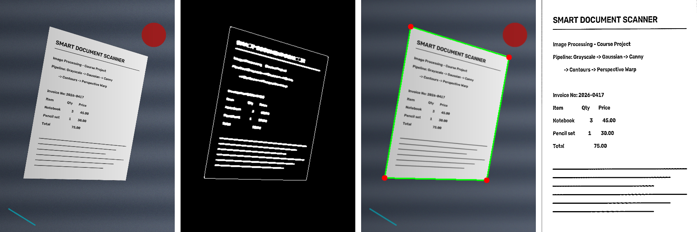

# Smart Document Scanner

**Automated perspective correction & edge detection tool** — turns skewed, carelessly
taken phone photos of documents into flat, readable, scanner-like images using
classical computer vision (no AI models).


<sub>Left to right: input photo → Canny edges → detected document corners → final scan</sub>

## Execution pipeline

| # | Stage | OpenCV | Purpose |
|---|-------|--------|---------|
| 1 | Grayscale conversion | `cvtColor` | Reduce 3 channels to intensity only |
| 2 | Gaussian filtering | `GaussianBlur` | Suppress noise & fine texture before edge detection |
| 3 | Canny edge detection | `Canny` + morphological close | Find strong gradients; close small gaps in the outline |
| 4 | Contour extraction | `findContours`, `approxPolyDP` | Pick the largest convex 4-corner polygon = the document |
| 5 | Perspective warping | `getPerspectiveTransform`, `warpPerspective` | Map the 4 corners to a rectangle (bird's-eye view) |

An optional final step applies adaptive thresholding for a clean black & white
"scanner" look (`--color` disables it).

### The math behind step 5
The 4 detected corners are ordered (top-left, top-right, bottom-right, bottom-left)
using the sums and differences of their coordinates. A 3×3 homography matrix **H** is
solved so that every source corner `(x, y)` maps to a destination corner `(x', y')`:

```
[x'·w]       [x]
[y'·w] = H · [y]
[  w ]       [1]
```

The output width/height come from the longest opposite edges, so the document keeps
its real aspect ratio. Detection runs on a downscaled copy (500 px height) for speed;
the corners are scaled back and the warp is applied to the full-resolution image.

## Installation

```bash
git clone https://github.com/3emirhan/smart-document-scanner.git
cd smart-document-scanner
python -m venv .venv
source .venv/bin/activate        # Windows: .venv\Scripts\activate
pip install -r requirements.txt
```

## Usage

```bash
# Single image
python -m scanner photo.jpg

# Whole folder, keep colors, save every intermediate step
python -m scanner examples/input -o output --color --debug

# Tune parameters for difficult photos
python -m scanner photo.jpg --canny 50 150 --blur 7

# Show results in a window
python -m scanner photo.jpg --show
```

Use it from Python:

```python
import cv2
from scanner import DocumentScanner

result = DocumentScanner().scan(cv2.imread("photo.jpg"))
cv2.imwrite("scan.png", result.scanned)
print(result.corners)          # 4 corners in the original image
# result.steps -> dict of every intermediate image
```

### Sample images
`examples/generate_samples.py` creates synthetic "phone photos" (a document warped with
a random perspective onto a cluttered background with uneven lighting):

```bash
python examples/generate_samples.py -n 5
```

## Tests

```bash
pytest
```

The tests check corner ordering, warp geometry and that detected corners on synthetic
photos are within 2% of the ground-truth positions.

## Project structure

```
smart-document-scanner/
├── scanner/
│   ├── pipeline.py     # 5-stage DocumentScanner class
│   ├── geometry.py     # corner ordering + perspective transform
│   ├── cli.py          # command-line interface
│   └── __main__.py     # enables `python -m scanner`
├── examples/
│   ├── generate_samples.py
│   ├── input/          # sample skewed photos
│   └── output/         # scanned results (+ intermediate steps)
├── tests/
└── requirements.txt
```

## Tips for best results
- Photograph the document on a background that contrasts with the paper.
- Make sure all four corners are visible in the frame.
- If detection fails, try lower Canny thresholds (`--canny 30 100`) or a larger blur.

## Team
- **Emirhan Biçer** — 220218004
- **Murat Aygen** — 220218031

Course: *Image Processing*

## License
MIT — see [LICENSE](LICENSE).
